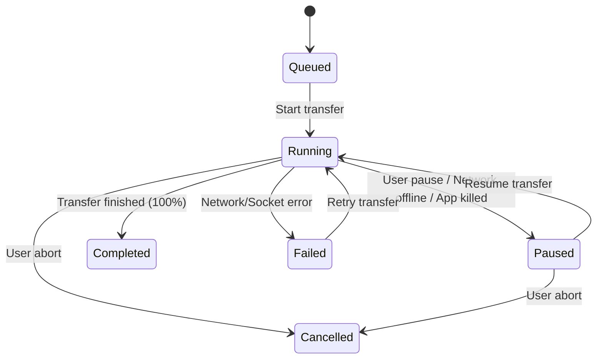

# Flutter POS: Background Upload & Download Module

**GitHub Repository:** https://github.com/Nurujjaman329/laantech_project  
**Mock API Base URL:** `http://108.136.142.112:90`  
**Target Platform:** Android (built and verified on physical hardware; see [Platform Support](#platform-support))

A resilient file transfer feature module for a **Point of Sale (POS) SaaS** stack using **Clean Architecture**, **Flutter BLoC**, **Dio**, and **System Tray Notifications**.

Built for mission-critical POS operations—such as importing massive product catalogs (>50MB CSV/media) and exporting financial/audit reports. Transfers run uninterrupted when the operator navigates between screens or minimizes the app, backed by real-time notification progress and resilient recovery after process interruption.

---

## Table of Contents
- [Quick Start](#quick-start)
- [Feature Checklist](#feature-checklist)
- [Screens & User Flow](#screens--user-flow)
- [Architecture & Key Design Decisions](#architecture--key-design-decisions)
- [State Machine](#state-machine)
- [Background Execution Strategy & Android Limits](#background-execution-strategy--android-platform-limits)
- [Resilience & Transfer Mechanics](#resilience--transfer-mechanics)
- [Assumptions](#assumptions)
- [Platform Support](#platform-support)
- [Testing & Verification](#testing--verification)
- [Build & Run](#build--run)
- [Known Limitations & Future Improvements](#known-limitations--future-improvements)

---

## Quick Start

1. `flutter pub get`
2. `flutter run` *(a physical Android device is recommended)*
3. On the login screen, tap **Register** to create an account against the mock API (or **Sign In** if already registered).
4. **Upload Tab**: Select an arbitrary local file, or tap **>50MB Sample** to generate a test CSV, then tap **Start Upload**.
5. **Download Tab**: Browse server files, tap **Download**, and once finished tap **Open** or **Share**.
6. Track transfers in real time via:
   - On-screen percentage and progress bars
   - The persistent floating banner (visible across all tabs)
   - The AppBar badge $\rightarrow$ expandable **Transfer Sheet**
   - The dedicated **Transfer Manager** screen
   - System notification tray (tapping routes directly back to the active transfer)

---

## Feature Checklist

| Requirement | Status | Where Implemented |
| :--- | :---: | :--- |
| **Pick large file & multipart upload** | Done | `UploadScreen`, `FileRemoteDataSourceImpl.uploadFile` |
| **Real-time percentage & progress bar** | Done | `UploadScreen`, `DownloadScreen`, `PersistentTransferBanner`, `TransferItemTile` |
| **Transfers survive tab navigation & minimize** | Done | Repository singleton + `flutter_foreground_task` typed `dataSync` FGS |
| **System notifications with deep link** | Done | `NotificationService` + `TransferNotificationRouter` (handles cold & warm start) |
| **Download server files** | Done | `DownloadScreen` querying `GET /get` |
| **Resumable downloads (HTTP Range)** | Done | `FileRemoteDataSourceImpl.downloadFileResumable` (`.part` buffer + HTTP 206) |
| **Global transfer dashboard** | Done | `PersistentTransferBanner` + `PersistentTransferSheet` + `TransferManagerScreen` |
| **Clean state management** | Done | `TransferBloc`, `FileListBloc`, `AuthBloc` (`flutter_bloc`) |
| **Pause, resume, retry, cancel** | Done | Byte-level resume for downloads; clean stream abort & restart for uploads |
| **Network failure handling & retry** | Done | `ConnectivityService` auto-pause, offline banner, `ErrorMessageMapper`, per-task retry |
| **Local storage & MediaStore export** | Done | App documents (`pos_downloads/`) + public `Downloads/POS_Transfers/` via Kotlin MediaStore channel |

---

## Screens & User Flow

```
                      ┌──────────────────────┐
                      │   Login / Register   │
                      └──────────┬───────────┘
                                 │
                                 ▼
                     ┌───────────────────────┐
                     │   HomeShellScreen     │
                     └───────────┬───────────┘
         ┌───────────────┬───────┴───────┬───────────────┬──────────────┐
         ▼               ▼               ▼               ▼              ▼
   [ Dashboard ]    [ Upload ]     [ Download ]    [ Transfers ]   [ Settings ]
   - Terminal stats - File picker  - Server files  - All/Active/   - Endpoints
   - 2x2 grid       - 50MB sample  - Resumable pull  Completed/    - Timeouts
   - Quick actions  - Live queue   - Open & Share    Failed filter - Sign out
                                                   - Retry All
   ───────────────────────────────────────────────────────────────────────────
   • Floating Banner + AppBar Badge (available on EVERY tab) --> Transfer Sheet
   • System Tray Notification Tap --> Routes to matching Tab + Transfer Sheet
```

| Screen | Responsibility |
| :--- | :--- |
| **Login / Register** | Authenticates against `POST /token` or creates new credentials; caches Bearer token in secure storage. |
| **Dashboard** | Overview of terminal sync status, 2x2 metric cards (Active, Completed, Failed, Total Volume), quick action buttons. |
| **Upload** | File picker, one-tap 50MB sample CSV generator, pre-upload validation, live progress, Pause / Resume / Retry / Cancel. |
| **Download** | Server file catalog (`GET /get`), resumable HTTP Range pull, deletion, and in-app Open (`open_filex`) / Share (`share_plus`). |
| **Transfer Manager** | Full-screen manager with instant search, tabbed status filters (`All`, `Active`, `Completed`, `Failed`), and batch "Retry All". |
| **Settings** | Backend endpoint transparency, timeout rules (`30s` connect / `60s` receive / `6h` upload send), notification throttle specs, session logout. |

---

## Architecture & Key Design Decisions

The application strictly adheres to **Clean Architecture** principles:

```
lib/
├── core/
│   ├── constants/             # API endpoints, timeouts, upload limits, storage keys
│   ├── di/                    # Centralized Dependency Injection Container (AppDependencies)
│   ├── errors/                # Failures, exceptions, ErrorMessageMapper
│   ├── network/               # DioClient (auth interceptor, debug API logs), ConnectivityService
│   ├── notifications/         # NotificationService, Foreground Service, tap router
│   ├── storage/               # Token storage, MediaStore public publisher, file validator
│   ├── theme/                 # Semantic Material 3 AppColors & AppTheme tokens
│   ├── usecase/               # Base UseCase contract
│   └── widgets/               # Shared POS banner and input widgets
├── features/
│   ├── auth/                  # Domain, Data, Presentation (Login & Register)
│   └── file_transfer/         # Transfer engine & Presentation
│       ├── data/              # FileRemoteDataSource, FileTransferRepositoryImpl
│       ├── domain/            # TransferTask, FileItem, UseCases, Repository interface
│       └── presentation/      # TransferBloc, FileListBloc, screens, widgets
├── app.dart                   # Root MaterialApp widget, theme & routing configuration
└── main.dart                  # App bootstrap, native channel setup & runApp
```

### Why This Design?
1. **Single Source of Truth**:
   `FileTransferRepositoryImpl` owns all in-flight Dio requests and transfer task states. It is completely independent of the widget lifecycle; leaving or popping screens never cancels active transfers.
2. **BLoC UI Adapter**:
   `TransferBloc` listens to the repository's broadcast `transferStream` and emits immutable states that feed all screens, badges, sheets, and notification bridges simultaneously.
3. **OS-Level Notifications & FGS Guard**:
   While the Foreground Service is active, its ongoing notification displays overall progress (e.g. `Uploading catalog.csv · 63%` or `2 transfers · 41% avg`). To prevent Android notification spam, individual progress notifications are throttled $\le 1$/s and deduplicated.
4. **Chunk Callback Throttling**:
   Raw socket chunk streams fire hundreds of times per second. The repository applies a dual throttle:
   - Stream updates: At most once per 250ms or on $\ge 1\%$ progress step.
   - Persistence writes: Immediate on status changes; at most once every 2 seconds during active streaming.

---

## State Machine



---

## Background Execution Strategy & Android Platform Limits

### What "Background" Means in This Module

| Scenario | Behavior |
| :--- | :--- |
| **Switching tabs / navigating screens** | Transfer **continues uninterrupted**. Sockets belong to the repository singleton, not UI widgets. |
| **App minimized (process kept alive)** | A typed `dataSync` **Foreground Service** with persistent tray notification keeps the process eligible to run. |
| **Swipe away from Recents / process death** | Open sockets are terminated by the OS. Tasks saved in `SharedPreferences` restore on launch as **paused** (`Transfer paused (app was closed)`). Operator taps **Resume**. |
| **Download resume after pause / process kill** | **Byte-level resume** via `.part` file + `Range: bytes={len}-` (HTTP 206). If the `.part` file is complete, HTTP 416 finalizes it as completed. |
| **Upload resume after pause / process kill** | **Restarts from 0%**. The mock server has no chunked/resumable upload endpoint (e.g. tus.io). |

### Android Platform Restrictions & Real-World Mitigations

| Android Restriction | Impact | Mitigation in This Module |
| :--- | :--- | :--- |
| **Doze Mode / App Standby** | CPU & network suspended when idle & screen off. | Active transfers run under a typed `dataSync` Foreground Service with `WAKE_LOCK`. Battery optimization exemption is intentionally omitted to respect Play Store policies. |
| **Android 14+ FGS Types** | Background execution without explicit service type is rejected. | Declared `android:foregroundServiceType="dataSync"` and registered `FOREGROUND_SERVICE_DATA_SYNC` permission. |
| **Android 15+ FGS Limits** | 6-hour cumulative dataSync execution ceiling per 24 hours. | Handled gracefully: transfers can be paused and resumed cleanly across sessions. |
| **Android 13+ Notification Permission** | Notifications blocked unless granted at runtime. | App requests `POST_NOTIFICATIONS` at startup. If denied, in-app transfers still function normally. |
| **Cleartext Traffic Policy** | Android blocks non-HTTPS HTTP traffic by default. | `android:usesCleartextTraffic="true"` configured to allow communication with the mock server (`http://108.136.142.112:90`). |
| **OEM Battery Managers (MIUI, OneUI, EMUI)** | Aggressive OEM managers kill background processes within minutes. | FGS significantly reduces termination risk; state persistence guarantees seamless manual or automatic resumption upon relaunch. |

---

## Resilience & Transfer Mechanics

### Resumable Downloads (HTTP Range)
1. Chunks are buffered into `{fileName}.part` inside `{ApplicationDocumentsDirectory}/pos_downloads/`.
2. On pause, crash, or network loss, the `.part` file remains intact on disk.
3. On resume: Sends request with `Range: bytes={existingLength}-`.
   - **HTTP 206 Partial Content**: Appends incoming bytes to `.part`.
   - **HTTP 200 OK**: Server ignored Range; restarts file cleanly from 0.
   - **HTTP 416 Range Not Satisfiable**: Local `.part` is already complete; promotes immediately to completed.
4. On success: Atomically renames `.part` $\rightarrow$ final file, then invokes Android `MediaStore` to copy into public `Downloads/POS_Transfers/`.

### Upload Resilience
- **Pre-flight Validation**: Checks existence, non-empty content, and enforces a 500MB cap (`ApiConstants.maxUploadBytes`).
- **Timeouts**: Uploads use an extended `6-hour` send timeout to prevent socket dropouts on massive files over low-bandwidth POS connections.
- **CancelToken**: Pausing immediately aborts the Dio stream and releases connection resources.

### Network Dropouts & Offline Handling
- **Auto-Pause**: `ConnectivityService` detects network loss, auto-pauses active transfers with reason `"Paused: network offline"`, and displays an offline banner under the AppBar.
- **Auto-Prompt Resume**: Once connectivity returns, a SnackBar prompts the operator to resume only those tasks that were paused by the network dropout (user-paused tasks remain paused).

---

## Assumptions

1. **Authentication**: The mock API requires a Bearer token. Registration and Login screens were implemented to acquire valid JWTs, cached securely via `flutter_secure_storage`.
2. **Upload Resumption**: Standard multipart `POST /upload` does not support byte ranges; restarting from 0% is the accepted standard until backend chunking (e.g. tus.io) is introduced.
3. **Size Limit**: Uploads are capped at 500MB (`ApiConstants.maxUploadBytes`) to prevent device memory exhaustion.
4. **Scoped Storage**: Downloaded files are retained in app-internal storage (for fast Range resumes) and exported to public `Downloads/POS_Transfers/` via `MediaStore` for user access in the system Files app.
5. **Platform Focus**: Full foreground service and scoped storage mechanisms target Android (minSdk 24+).

---

## Platform Support

* **Android (Primary)**: Fully implemented and verified on Android 8 through 16 (minSdk 24, compileSdk 36).
* **iOS**: UI, BLoC, and foreground transfers function cleanly; true background transfers would require native `NSURLSessionConfiguration.backgroundSessionConfiguration` or `BGProcessingTaskRequest`.
* **Legacy Android (Android 9 and below)**: When MediaStore Scoped Storage is unavailable, the module safely falls back to standard external storage directories.

---

## Testing & Verification

### Automated Test Suite
Run the full test suite with:
```bash
flutter analyze
flutter test
```
* **116 automated tests passing** across unit, repository, BLoC, and widget layers (including 416 edge cases, throttle timing, auth expiry streams, and navigation).

### 11-Step Hardware Verification Matrix

| # | Test Scenario | Procedure | Expected Result |
| :-: | :--- | :--- | :--- |
| **1** | **Tab Navigation** | Start a 50MB upload, switch between Dashboard, Download, and Settings. | Transfer progresses uninterrupted; floating banner shows live %. |
| **2** | **App Minimized** | Start a download, press Home button, wait 30 seconds, reopen. | Foreground notification updates progress; download continues smoothly. |
| **3** | **Screen Off / Doze** | Start transfer, lock screen for 5+ minutes. | Transfer continues to completion under the `dataSync` FGS. |
| **4** | **Process Kill / Swipe** | Start transfer, swipe app away from Recents, relaunch. | Restores as `paused` ("app was closed"); tapping Resume resumes download from `.part` offset. |
| **5** | **Airplane Mode** | Toggle Airplane Mode during transfer. | Auto-pauses with offline banner; reconnecting shows Resume prompt. |
| **6** | **Download Resume** | Pause download at ~40%, resume after 10s. | Resumes from 40% (HTTP 206); byte length matches server exactly. |
| **7** | **Upload Resume** | Pause upload at ~50%, resume. | Restarts from 0% (server constraint) and completes successfully. |
| **8** | **Public Files** | Complete a download, open system **Files** app. | File is visible and openable under `Downloads/POS_Transfers/`. |
| **9** | **Notification Tap** | Tap transfer notification while minimized or from cold start. | App launches directly into the matching tab and opens the transfer sheet. |
| **10** | **Android 13+ Perms** | Fresh app install on Android 13+. | Runtime notification permission prompt appears as expected. |
| **11** | **Error Edge Cases** | Attempt empty file, >500MB file, or expired token. | Clear, friendly error dialogs appear; 401 redirects to login. |

---

## Build & Run

### Prerequisites
- **Flutter SDK**: 3.27+ (Dart ^3.13.5)
- **Android SDK**: compileSdk 36, minSdk 24
- **JDK**: 17

### Commands
```bash
flutter pub get
flutter test
flutter run
flutter build apk --debug
```

Debug APK output location:
```
build/app/outputs/flutter-apk/app-debug.apk
```

---

## Known Limitations & Future Improvements

1. **Upload Byte-Level Resume**: Requires backend protocol support (e.g., tus.io or AWS S3 multipart chunking).
2. **Headless Interruption Recovery**: Currently relies on FGS while minimized and manual 1-tap Resume after process death. Future iterations can integrate `WorkManager` with a SQLite queue (`sqflite`/`Drift`) for autonomous headless restart.
3. **Cellular Data Policies**: Could introduce an operator preference to restrict 50MB+ transfers to unmetered Wi-Fi.
4. **Storage Deduplication**: Once verified by the operator, files could be moved rather than copied from app-private storage to public Downloads.
